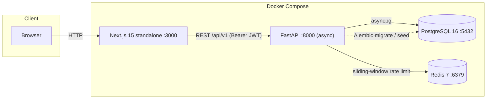
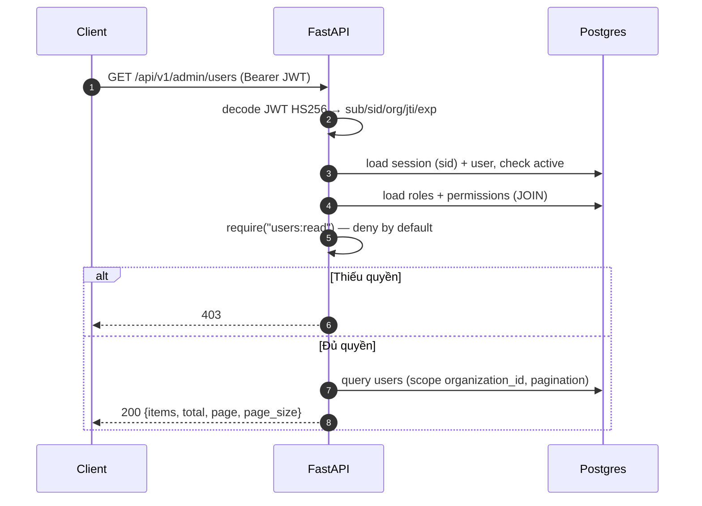
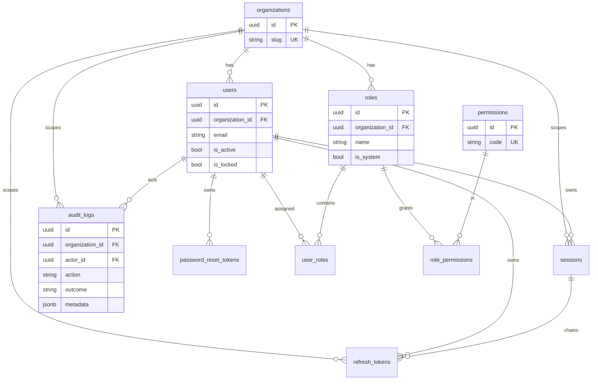
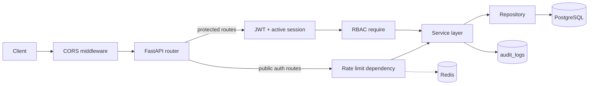

# PROJECT STATUS — IAM Platform

- **Ngày audit:** 2026-11-13
- **Phạm vi:** toàn bộ repo `G:\PRJ1\iam-platform` (backend, frontend, DB, Docker, docs)
- **Phương pháp:** đọc mã nguồn + chạy kiểm chứng thực tế (`pytest`, `pytest --cov`, `ruff`, dump route FastAPI, `docker compose ps`)
- **Lưu ý:** repo **không phải git repository** → không có commit/branch history để đối chiếu. Mọi kết luận dưới đây dựa trên trạng thái file hiện tại và runtime.
- **Không có file source nào bị sửa đổi** trong quá trình audit.

---

## 1. Tổng quan dự án

Hệ thống IAM nội bộ gồm backend FastAPI (async), PostgreSQL 16, Redis 7 và frontend Next.js 15. Phạm vi hiện tại: authentication (JWT + refresh rotation), RBAC, quản trị user/role/permission, audit log, security events, rate limiting và UI quản trị đầy đủ.

| Chỉ số | Giá trị | Nguồn |
|---|---|---|
| Backend Python files | 62 file / 3.516 LOC (`backend/app`) | đếm file |
| Frontend TS/TSX | 69 file / 3.873 LOC (`frontend/src`) | đếm file |
| API endpoints | 27 endpoint `/api/v1` + `GET /health` | dump `app.routes` |
| Database tables | 10 | migration `0001_initial_schema.py` |
| Backend tests | **40 passed** (14 file test) | `pytest -q` (2026-11-13) |
| Backend coverage | **70%** (1.651 stmts, 495 miss) | `pytest --cov=app` |
| Frontend pages | 11 `page.tsx` | glob `app/**/page.tsx` |
| Containers | 4/4 Up; postgres & redis healthy | `docker compose ps` |

---

## 2. Cấu trúc thư mục

```
iam-platform/
├── .env / .env.example          # secrets thật trong .env (đã gitignore)
├── .gitignore
├── docker-compose.yml           # dev compose: 4 services
├── README.md
├── docs/
│   ├── architecture.md          # quyết định D1–D43 + known tech debt
│   └── api-design.md            # API spec Phase 2–4
├── backend/
│   ├── Dockerfile               # multi-stage, non-root appuser
│   ├── alembic.ini
│   ├── requirements.txt / requirements-dev.txt
│   ├── migrations/versions/0001_initial_schema.py
│   ├── app/
│   │   ├── api/                 # deps, deps_rbac, deps_ratelimit, v1/{auth,users}, v1/admin/*
│   │   ├── core/                # config, logging, redis
│   │   ├── db/                  # Base, async engine/session
│   │   ├── models/              # 10 SQLAlchemy models
│   │   ├── schemas/             # auth, user, admin, audit, dashboard
│   │   ├── security/            # tokens, password, permissions, ratelimit, audit redact
│   │   ├── services/            # auth, user_admin, role, audit, dashboard
│   │   ├── repositories/        # user, session, refresh_token, password_reset, audit, role, permission
│   │   ├── scripts/seed.py
│   │   └── main.py
│   └── tests/                   # 14 test files + conftest.py
└── frontend/
    ├── Dockerfile               # multi-stage, Next standalone
    ├── next.config.ts / tsconfig.json / tailwind / postcss / eslint configs
    └── src/
        ├── app/                 # (auth)/login,register; (app)/dashboard,users,roles,permissions,audit,security,profile
        ├── components/          # ui primitives, layout, Can gate
        ├── features/            # dashboard, users, roles, permissions, audit, profile
        ├── hooks/               # use-permissions
        ├── lib/api/             # client, auth, users, admin, audit, types
        └── stores/              # auth-store (zustand persist sessionStorage)
```

---

## 3. Kiến trúc hệ thống

### 3.1 System architecture



### 3.2 Auth flow (login + refresh rotation)

```mermaid
sequenceDiagram
    autonumber
    participant C as Client
    participant A as FastAPI
    participant R as Redis
    participant D as Postgres
    C->>A: POST /api/v1/auth/login {email, password}
    A->>R: check login:ip (sorted-set Lua)
    alt Vượt limit
        A-->>C: 429 + Retry-After
    end
    A->>D: user theo (organization_id, email)
    A->>A: Argon2id verify + lockout check
    alt Sai mật khẩu / bị khoá
        A->>D: failed_login_attempts++ (>=5 → lock 15m) + audit
        A-->>C: 401 / 423
    else Hợp lệ
        A->>D: tạo session + refresh token (sha256, family chain) + audit
        A-->>C: TokenPair (access JWT 15m, refresh opaque 7d)
    end
    Note over C,D: Refresh: SELECT FOR UPDATE → rotate token;<br/>token đã dùng → revoke toàn bộ family + session, trả 401
```

### 3.3 Authorization flow (RBAC per-request)



### 3.4 ER diagram



### 3.5 Request flow



---

## 4. Tech Stack

| Layer | Công nghệ | Version | Nguồn |
|---|---|---|---|
| Backend | Python | 3.12 | `Dockerfile` |
| | FastAPI | 0.115.6 | `requirements.txt` |
| | Uvicorn | 0.34.0 | `requirements.txt` |
| | SQLAlchemy (async) | 2.0.36 | `requirements.txt` |
| | asyncpg | 0.30.0 | `requirements.txt` |
| | Alembic | 1.14.0 | `requirements.txt` |
| | Pydantic / pydantic-settings | 2.10.4 / 2.7.0 | `requirements.txt` |
| | python-jose | 3.3.0 | `requirements.txt` |
| | argon2-cffi | 23.1.0 | `requirements.txt` |
| | redis-py | 5.2.1 | `requirements.txt` |
| | email-validator | 2.2.0 | `requirements.txt` |
| Backend dev | pytest / pytest-asyncio / pytest-cov | 8.3.4 / 0.25.0 / 6.0.0 | `requirements-dev.txt` |
| | httpx / ruff / mypy | 0.28.1 / 0.8.4 / 1.14.0 | `requirements-dev.txt` |
| Frontend | Next.js | 15.1.3 | `package.json` |
| | React / React DOM | 19.0.0 | `package.json` |
| | TypeScript | ^5.7.2 | `package.json` |
| | TanStack Query | ^5.62.0 | `package.json` |
| | Zustand | ^5.0.2 | `package.json` |
| | Tailwind CSS | ^3.4.17 | `package.json` |
| | ESLint | ^9.17.0 | `package.json` |
| Database | PostgreSQL | 16-alpine | `docker-compose.yml` |
| Cache/Rate limit | Redis | 7-alpine | `docker-compose.yml` |
| Infra | Docker Compose | — | `docker-compose.yml` |

---

## 5. Trạng thái tính năng

| Tính năng | Trạng thái | Bằng chứng |
|---|---|---|
| Register / Login / JWT access | COMPLETE | `api/v1/auth.py`, `security/tokens.py`, test `test_auth.py` |
| Account lockout (5 fail → 15m) | COMPLETE | `auth_service.py`, `test_lockout.py` |
| Refresh rotation + reuse detection | COMPLETE | `refresh_token_repo.get_by_hash_for_update`, `test_refresh_rotation.py` (4 test) |
| Logout / logout-all / change-password | COMPLETE | `api/v1/auth.py` (8 route), revoke session + refresh |
| Forgot / reset password | **PARTIAL** | Endpoint + token + test có, nhưng **không có email service**: dev log raw token; production raise `RuntimeError` → 500 (`auth.py:187-192`) |
| RBAC (8 permissions, 5 seed roles) | COMPLETE | `security/permissions.py`, `seed.py`, `test_rbac.py`, `test_multi_role.py` |
| Privilege escalation prevention | COMPLETE | `user_admin_service`, `test_privilege_escalation.py` (3 test) |
| Admin users CRUD + search + pagination | COMPLETE | `api/v1/admin/users.py`, `test_admin_users.py` |
| Role management | COMPLETE | `api/v1/admin/roles.py`, `test_admin_roles.py` |
| Permission catalog (read-only) | COMPLETE | `api/v1/admin/permissions.py` |
| Audit logs (filter + 90-day limit) | COMPLETE | `audit.py`, `audit_service.py`, `test_audit_query.py` |
| Security events | **PARTIAL** | Endpoint hoạt động, nhưng query param `actor_id` **bị bỏ qua**; action `security.ratelimit_exceeded` không bao giờ được ghi DB (chỉ `logger.warning`) |
| Rate limiting | **PARTIAL** | Chỉ IP-level (`login/register/refresh/forgot:ip`); `RATELIMIT_LOGIN_ACCOUNT_*`, `RATELIMIT_FORGOT_EMAIL_*` có trong config nhưng **không được dùng** |
| Dashboard stats | COMPLETE | `api/v1/admin/dashboard.py`, `test_dashboard.py`, frontend stats |
| Frontend auth + app UI | COMPLETE | 11 page, build 13 route, smoke test Phase 5 pass |
| Tenant management (multi-org) | NOT IMPLEMENTED | Single org qua `get_default_organization` |
| Email service | NOT IMPLEMENTED | Không có SMTP/provider |
| CI/CD | NOT IMPLEMENTED | Không có `.github/`; README lại ghi “GitHub Actions” |
| Frontend automated tests | NOT IMPLEMENTED | `package.json` không có test script/framework |
| Test DB độc lập | NOT IMPLEMENTED | `conftest.py`: dùng chung DB dev, “Phase 6 sẽ tách” |
| mypy typecheck | UNVERIFIED | Đã cài nhưng không có config/không có bằng chứng chạy |
| Concurrent refresh test | NOT IMPLEMENTED | Tech debt ghi trong `docs/architecture.md` |
| SQLi test | NOT IMPLEMENTED | Không có test tương ứng (Phase 6) |

---

## 6. Audit Database

10 bảng, UUID v4 PK, `TIMESTAMPTZ`, tenant-scoped qua `organization_id`.

| Bảng | Ràng buộc / Index chính | Ghi chú |
|---|---|---|
| `organizations` | `slug` UNIQUE | 1 org mặc định (seed) |
| `users` | `uq_users_org_email`; index `organization_id`, `email` | Soft delete (`is_active`); lockout fields |
| `roles` | `uq_roles_org_name`; index `organization_id` | `is_system` bảo vệ role hệ thống |
| `permissions` | `code` UNIQUE | Catalog global, read-only API |
| `user_roles` | PK tổ hợp `(user_id, role_id)`; FK CASCADE | `assigned_at` |
| `role_permissions` | PK tổ hợp `(role_id, permission_id)`; FK CASCADE | — |
| `sessions` | index `user_id`, `organization_id`; FK CASCADE | `revoked_at`, `last_seen_at` |
| `refresh_tokens` | `token_hash` UNIQUE; index user/session/org/family/expires | Family chain `parent_id`/`replaced_by_id` (`SET NULL`) |
| `password_reset_tokens` | `token_hash` UNIQUE; index `user_id`; FK CASCADE | TTL 30 phút |
| `audit_logs` | index org/actor/action/outcome/created_at; `metadata` JSONB | `actor_id` FK `SET NULL` để giữ log; append-only ở app layer |

**Phát hiện:**
- Ràng buộc tenant/unique đầy đủ và đúng cho các luồng hiện tại (`(org, email)`, `(org, role name)`).
- Append-only chỉ enforce ở repository (không có trigger/revoke DB) — đã ghi nhận là tech debt có chủ đích.
- Chỉ có 1 migration (`0001`); `migrations/env.py` đọc `DATABASE_URL` từ Settings (đúng, không dùng placeholder trong `alembic.ini`).
- **Dev DB bị ô nhiễm bởi test**: smoke test thấy 200 users, 32 roles (seed chỉ tạo 5), 756 audit logs; test tạo email dạng `user+<uuid>@example.com` trên cùng DB dev.

---

## 7. API Inventory

Tất cả dưới prefix `/api/v1` (trừ `/health`). Verified bằng dump `app.routes`.

| # | Method | Path | Auth / Permission | Trạng thái |
|---|---|---|---|---|
| 1 | GET | `/health` | public | OK (`phase:"4"` — stale) |
| 2 | POST | `/auth/register` | public + rate limit | OK |
| 3 | POST | `/auth/login` | public + rate limit | OK |
| 4 | POST | `/auth/refresh` | public + rate limit | OK |
| 5 | POST | `/auth/logout` | public (refresh token) | OK |
| 6 | POST | `/auth/change-password` | Bearer | OK |
| 7 | POST | `/auth/forgot-password` | public + rate limit | Dev: log token; Prod: **500** |
| 8 | POST | `/auth/reset-password` | public | OK |
| 9 | POST | `/auth/logout-all` | Bearer | OK |
| 10 | GET | `/users/me` | Bearer | OK |
| 11 | GET | `/users/me/permissions` | Bearer | OK (không có trong api-design.md) |
| 12 | PATCH | `/users/me` | Bearer | OK |
| 13 | GET | `/users/me/sessions` | Bearer | OK |
| 14 | GET | `/admin/users` | `users:read` | OK |
| 15 | POST | `/admin/users` | `users:create` | OK |
| 16 | GET | `/admin/users/{id}` | `users:read` | OK (cross-org → 404) |
| 17 | PATCH | `/admin/users/{id}` | `users:update` | OK |
| 18 | DELETE | `/admin/users/{id}` | `users:delete` | OK (soft delete) |
| 19 | PUT | `/admin/users/{id}/roles` | `users:update` | OK (full replace) |
| 20 | DELETE | `/admin/users/{id}/sessions` | `sessions:revoke` | OK |
| 21 | GET | `/admin/roles` | `roles:read` | OK |
| 22 | POST | `/admin/roles` | `roles:manage` | OK |
| 23 | PATCH | `/admin/roles/{id}` | `roles:manage` | OK (chỉ description) |
| 24 | DELETE | `/admin/roles/{id}` | `roles:manage` | OK (system role → 400, còn user → 409) |
| 25 | GET | `/admin/permissions` | `roles:read` | OK |
| 26 | GET | `/admin/audit-logs` | `audit:read` | OK |
| 27 | GET | `/admin/dashboard/stats` | `users:read` | OK (không có trong api-design.md) |
| 28 | GET | `/admin/security-events` | `audit:read` | OK, nhưng `actor_id` bị bỏ qua |

Ghi chú: OpenAPI tổng cộng 32 route (28 route trên + 4 route docs `/openapi.json`, `/docs`, `/redoc`, `/docs/oauth2-redirect`).

---

## 8. Testing & Quality

**Backend (chạy lại trong audit):**
- `pytest -q` → **40 passed, 55 warnings, 11.98s**.
- `pytest --cov=app` → **70%** (1.651 statements, 495 missed), 30.67s.
- `ruff check app tests migrations` → **All checks passed**.

| Module | Coverage | Nhận xét |
|---|---|---|
| `app/models/*`, `schemas/*`, `main.py`, `deps_ratelimit.py` | 93–100% | Tốt |
| `security/tokens.py` | 92% | Tốt |
| `repositories/*` | 67–100% | Khá |
| `api/v1/admin/users.py` | 53% | Nhiều nhánh chưa test |
| `api/v1/auth.py` | 56% | Forgot/reset/logout-all ít test |
| `services/auth_service.py` | **32%** | Rủi ro cao (logic bảo mật phức tạp) |
| `services/user_admin_service.py` | **33%** | Rủi ro cao (invariants phân quyền) |
| `services/role_service.py` | **43%** | Rủi ro trung bình |
| `scripts/seed.py` | **0%** | Không test (dùng tay) |

**Test files (14):** `test_health`, `test_auth`, `test_refresh_rotation`, `test_lockout`, `test_password_reset`, `test_rbac`, `test_multi_role`, `test_privilege_escalation`, `test_admin_users`, `test_admin_roles`, `test_audit_query`, `test_redaction`, `test_ratelimit`, `test_dashboard`.

**Vấn đề chất lượng:**
- Test chạy trên **DB dev dùng chung** (không isolated) → dữ liệu tích tụ, phụ thuộc thứ tự/seed; `conftest.py` ghi rõ “Phase 6 sẽ tách test DB”.
- Không có coverage threshold/gate; `pytest-cov` chỉ được cài.
- `mypy` được cài nhưng **không có config và không có bằng chứng chạy**.
- 55 warnings: `pytest-asyncio` chưa set `asyncio_default_fixture_loop_scope` (do không có `pytest.ini`/`pyproject.toml`); python-jose dùng `datetime.utcnow()` deprecated.
- Frontend không có test tự động (không có Vitest/Playwright/Jest); chỉ có bằng chứng `next build` + smoke test thủ công ở Phase 5.
- Không có test concurrent refresh (race), SQLi, XSS.

---

## 9. Docker & Deployment

| Service | Image | Port | Healthcheck | Ghi chú |
|---|---|---|---|---|
| `postgres` | postgres:16-alpine | 55432→5432 | pg_isready | Volume `postgres_data` |
| `redis` | redis:7-alpine | 6379→6379 | redis-cli ping | **Không auth**, expose host |
| `backend` | build `./backend` | 8000 | Không | Bind-mount `./backend:/app` + `--reload` (dev) |
| `frontend` | build `./frontend` | 3000 | Không | Next standalone; `NEXT_PUBLIC_API_URL` bake lúc build |

**Phát hiện deployment:**
- Compose hiện tại là **dev-only**: `--reload`, bind mount source, Postgres/Redis expose ra host, không resource limit, không TLS/reverse proxy.
- Backend Dockerfile: multi-stage `python:3.12-slim`, chạy **non-root `appuser`** — tốt.
- Frontend Dockerfile: multi-stage `node:20-alpine`, output standalone — tốt; nhưng `NEXT_PUBLIC_API_URL` là build-time → đổi URL phải rebuild.
- `NEXT_PUBLIC_API_URL` mặc định `http://localhost:8000` (phù hợp dev, cần đổi khi deploy).
- Secrets thật nằm trong `.env` (SECRET_KEY, POSTGRES_PASSWORD, SEED_ADMIN_PASSWORD); `.gitignore` đã loại `.env`; `Settings` chặn `SECRET_KEY=CHANGE_ME...`.
- Redis không có password và mở cổng host → rủi ro nếu máy host lộ.
- Không có `docker-compose.prod.yml`, không có CI/CD (`.github/` không tồn tại).

---

## 10. Tài liệu

| Tài liệu | Trạng thái | Vấn đề |
|---|---|---|
| `README.md` | **Lỗi thời** | Phase 5 vẫn `[ ]` dù đã hoàn tất; ghi “GitHub Actions” nhưng repo không có workflow nào |
| `docs/architecture.md` | Tốt (Phase 1–4) | Module layout thiếu `dashboard_service`; chưa cập nhật Phase 5; danh sách tech debt vẫn chính xác |
| `docs/api-design.md` | **Lỗi thời** | Thiếu `/users/me/permissions` và `/admin/dashboard/stats`; mô tả `security-events` có `actor_id` nhưng implementation bỏ qua param |
| OpenAPI runtime | OK | `/docs` khả dụng; version app `0.4.0-phase4`, health `phase:"4"` chưa cập nhật Phase 5 |
| Git history | **Không có** | Thư mục không phải git repo |

---

## 11. Phase hiện tại

| Phase | Nội dung | Trạng thái | Bằng chứng |
|---|---|---|---|
| 1 | Foundation (models, migration, config, docker) | COMPLETE | Migration 0001, compose, seed |
| 2 | Authentication | COMPLETE | 8 auth endpoint, test pass |
| 3 | Authorization (RBAC) | COMPLETE | Admin API, test RBAC/escalation |
| 4 | Security & Audit | COMPLETE | Rate limit IP, audit query, redaction test |
| 5 | Frontend + dashboard | **COMPLETE** | 11 page, 40 test pass, smoke test |
| 6 | Quality & Delivery | **NOT STARTED** | Không CI, không test DB riêng, không email service |

**Mức hoàn thành:** 5/6 phase ≈ **83%** theo phase. Coverage backend 70%. Phase 6 = 0%.
**Tín hiệu version chưa đồng bộ:** `main.py` vẫn `0.4.0-phase4`, `/health` trả `phase:"4"` dù Phase 5 đã xong.

---

## 12. Gaps & Tech Debt

| ID | Mức | Khu vực | Vấn đề (evidence) | Tác động |
|---|---|---|---|---|
| C1 | CRITICAL | Auth | Không có email service; `forgot-password` production raise `RuntimeError` → 500 (`api/v1/auth.py:187-192`) | Không thể dùng chức năng reset mật khẩu khi deploy |
| C2 | CRITICAL | Delivery | Không có CI/CD (`.github/` trống; README ghi GitHub Actions) | Không có gate build/test/deploy tự động |
| C3 | CRITICAL | Deployment | Compose dev-only: `--reload`, bind mount, Redis không auth + expose, Postgres expose, không resource limit/quản lý secrets | Không sẵn sàng production |
| H1 | HIGH | Testing | Test dùng chung DB dev; 200 users / 32 roles / 756 audit logs tích tụ | Test không deterministic, dữ liệu dev bẩn |
| H2 | HIGH | Security | Account-level login limit và `forgot:email` chưa enforce; settings tồn tại nhưng unused (`deps_ratelimit.py`) | Brute-force theo email/nguồn phân tán chưa bị chặn |
| H3 | HIGH | Frontend | Không có test tự động (không framework/script) | Regression UI không được phát hiện |
| H4 | HIGH | Audit | `security-events` bỏ qua `actor_id`; `security.ratelimit_exceeded` không bao giờ persist (`logger.warning` only) | Filter không hoạt động; sự kiện rate-limit không truy vết được |
| H5 | HIGH | Frontend security | Tokens lưu `sessionStorage`; không có CSP/security headers (`next.config.ts`) | XSS có thể đánh cắp refresh token |
| H6 | HIGH | Testing | Coverage 70%; `auth_service` 32%, `user_admin_service` 33%, `role_service` 43%; không gate | Logic bảo mật quan trọng chưa được test đủ |
| H7 | HIGH | Quality | `mypy` cài nhưng không config/không chạy | Lỗi type không được phát hiện |
| H8 | HIGH | Audit | Append-only chỉ ở app layer, không trigger/revoke DB | Log có thể bị sửa bởi DB admin |
| M1 | MEDIUM | Docs | README/api-design lỗi thời; health/version stale | Onboarding và vận hành dễ sai |
| M2 | MEDIUM | Performance | `list_users` gọi `_to_read` từng user → **N+1 query**; `list_roles` tương tự; dashboard 6 query tuần tự | Chậm khi dữ liệu tăng |
| M3 | MEDIUM | Security | Permission JOIN mỗi request, không cache (D21/D36) | Tăng tải DB khi scale |
| M4 | MEDIUM | Tenant | Chỉ 1 org mặc định, không endpoint/UI quản lý tenant | Chưa dùng được multi-tenant thực tế |
| M5 | MEDIUM | Frontend | Không có `middleware.ts`; bảo vệ route hoàn toàn client-side | Flash nội dung trước khi redirect; API vẫn được bảo vệ |
| L1 | LOW | Quality | Không có `pytest.ini`/`pyproject.toml` → warning `pytest-asyncio`; không cấu hình ruff/mypy tập trung | Warning noise, thiếu chuẩn hóa |
| L2 | LOW | Build | `eslint.ignoreDuringBuilds: true` trong `next.config.ts` | Lỗi lint có thể lọt qua build |
| L3 | LOW | Repo | Không phải git repo | Không có history/rollback/review |
| L4 | LOW | Ops | Không healthcheck cho backend/frontend trong compose; không resource limit | Khó giám sát/ổn định |
| L5 | LOW | Build | `NEXT_PUBLIC_API_URL` bake lúc build | Đổi môi trường phải rebuild |

---

## 13. Next Action Plan

Ưu tiên theo thứ tự (Phase 6):

1. **Email service + hoàn thiện forgot-password**
   - Tích hợp provider (SMTP/SES/Resend), gửi link chứa token; bỏ log raw token.
   - Acceptance: production không còn 500; token một lần, hết hạn 30 phút; test gửi mail (mock).

2. **Tách test DB + coverage gate**
   - Thêm service/schema test riêng (hoặc transaction rollback per test); reset DB trước suite.
   - Acceptance: test không tạo dữ liệu vào DB dev; coverage tối thiểu (đề xuất 80%) fail CI nếu dưới ngưỡng.

3. **CI/CD (GitHub Actions)**
   - Jobs: backend `ruff` + `pytest --cov`; frontend `typecheck` + `lint` + `build`; (tuỳ chọn) build Docker images.
   - Acceptance: PR bắt buộc pass; workflow chạy trên push/PR; README cập nhật đúng.

4. **Enforce account-level rate limit + audit rate-limit events**
   - Chuyển `login:account` và `forgot:email` xuống service sau khi parse body; ghi audit `security.ratelimit_exceeded` (hoặc bỏ khỏi catalog nếu giữ log-only).
   - Acceptance: test 429 theo email; security-events hiển thị được sự kiện.

5. **Hardening production deployment**
   - Tạo compose prod/overlay: bỏ `--reload`/bind mount, Redis password + không expose public, reverse proxy/TLS, healthcheck, resource limit, secrets ngoài file.
   - Acceptance: stack chạy với image immutable; healthcheck xanh; không port DB/Redis ra ngoài.

6. **Frontend quality & security**
   - Thêm Playwright smoke (login → dashboard → users) + Vitest cho lib; thêm CSP/security headers; quyết định chiến lược token storage (httpOnly cookie nếu có BFF).
   - Acceptance: test UI chạy trong CI; CSP không phá app.

7. **Dọn nợ kỹ thuật còn lại**
   - Implement hoặc bỏ `actor_id` ở security-events; sửa N+1 ở list users/roles; bổ sung test concurrent refresh + SQLi; cập nhật README/api-design/version; khởi tạo git repo.

---

## 14. Executive Summary

- **Nền tảng cốt lõi vững:** authentication, refresh rotation chống reuse, RBAC chống privilege escalation/IDOR, audit redaction và frontend quản trị đầy đủ; **40 test pass, ruff clean, coverage 70%**.
- **Phase 5 đã hoàn tất** (dashboard + toàn bộ UI); dự án đạt ~**83%** theo phase (5/6).
- **Chưa production-ready:** thiếu email service (C1), CI/CD (C2) và cấu hình deploy production (C3); test chưa isolate DB và frontend chưa có test tự động.
- **Rủi ro bảo mật cần xử lý sớm:** account-level rate limit chưa enforce, tokens trong `sessionStorage` không CSP, audit rate-limit không được persist, coverage thấp ở các service phân quyền.
- **Khuyến nghị:** bắt đầu Phase 6 theo thứ tự email service → test DB/coverage gate → CI → rate limit/audit → hardening deploy; trong lúc đó sửa docs/version để trạng thái phản ánh đúng thực tế.

> Báo cáo được tạo từ kiểm tra mã nguồn và chạy kiểm chứng thực tế ngày 2026-11-13; không có file source nào bị thay đổi.
