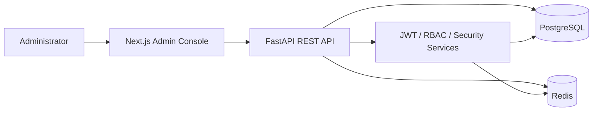

# IAM Platform

A full-stack Identity and Access Management (IAM) platform for managing users, roles, permissions, authentication sessions, and security activity in an organization.

Built as an AI Engineering portfolio project, this MVP demonstrates practical backend engineering, role-based access control (RBAC), authentication security, auditability, and a working administration interface.

> **Project status:** MVP / portfolio demo. The application runs locally with Docker Compose. It is not presented as a production-hardened identity provider.

## Overview

IAM Platform provides an administrator console backed by an asynchronous FastAPI service. Administrators can manage organization users, assign roles, inspect permissions, review audit records, and monitor security events.

### Core capabilities

- **Authentication:** account registration and login, JWT access tokens, refresh-token rotation, refresh-token reuse detection, logout, logout-all, and password changes.
- **Account protection:** failed-login lockout and IP-based rate limiting.
- **Authorization:** role-based access control (RBAC), permission catalog, role assignment, and authorization checks on protected API routes.
- **User administration:** list, search, inspect, update, activate/deactivate, assign roles, revoke sessions, and delete users through the admin interface/API.
- **Auditability:** searchable audit log with action, actor, outcome, and date filters; security-event views.
- **Admin frontend:** dashboard, users, roles, permissions, audit log, security events, and profile pages.

## Screenshots

The application includes a browser-based admin console. Screenshots of the running application are being prepared for this section and will be committed under `docs/images/`.

## Architecture



### Technology stack

| Layer | Technologies |
|---|---|
| Frontend | Next.js 15, React 19, TypeScript, Tailwind CSS |
| Backend | Python 3.12, FastAPI, Pydantic |
| Persistence | PostgreSQL 16, SQLAlchemy 2.x async, Alembic |
| Cache / rate limiting | Redis 7 |
| Authentication | JWT, refresh-token rotation, Argon2id password hashing |
| Testing / quality | Pytest, Ruff |
| Local environment | Docker Compose |

## Run locally

### Prerequisites

- Docker Desktop with Docker Compose
- Git
- A terminal (PowerShell, Windows Terminal, Git Bash, or macOS/Linux shell)

### 1. Clone the repository

```bash
git clone https://github.com/ATishere/iam-platform.git
cd iam-platform
```

### 2. Configure environment variables

Copy the example file:

**Windows PowerShell**
```powershell
Copy-Item .env.example .env
```

**Git Bash / macOS / Linux**
```bash
cp .env.example .env
```

Edit `.env` and replace all placeholder values, especially:

- `SECRET_KEY`
- `POSTGRES_PASSWORD`
- `DATABASE_URL` (keep its password consistent with `POSTGRES_PASSWORD`)
- `SEED_ADMIN_PASSWORD`

Generate a strong application secret:

```bash
python -c "import secrets; print(secrets.token_urlsafe(64))"
```

Never commit your real `.env` file or share real credentials in screenshots.

### 3. Start the application

```bash
docker compose up -d --build
```

Check container status:

```bash
docker compose ps
```

### 4. Apply database migrations and seed initial data

```bash
docker compose exec backend alembic upgrade head
docker compose exec backend python -m app.scripts.seed
```

The seed script is designed to be idempotent. It creates the default organization, permission catalog, predefined roles, and the administrator configured by `SEED_ADMIN_EMAIL` and `SEED_ADMIN_PASSWORD`.

### 5. Open the application

| Service | URL |
|---|---|
| Admin frontend | http://localhost:3000 |
| Backend API | http://localhost:8000 |
| OpenAPI / Swagger UI | http://localhost:8000/docs |
| Health endpoint | http://localhost:8000/health |

Sign in with the administrator credentials configured in your local `.env`. Do not assume public demo credentials are available.

### 6. Stop the application

```bash
docker compose down
```

To also remove local database and Redis volumes (this permanently deletes local persisted data):

```bash
docker compose down -v
```

## Testing

Run the backend test suite inside the backend container:

```bash
docker compose exec backend pytest -q
```

The latest project status report recorded **40 passing backend tests** and **70% backend coverage** at the time of that audit. These are point-in-time results, not a guarantee that every environment or later commit produces the same result. Re-run the test suite to verify the current checkout.

Run lint checks:

```bash
docker compose exec backend ruff check .
```

## API surface

The API is versioned under `/api/v1`. Explore the live OpenAPI schema at [http://localhost:8000/docs](http://localhost:8000/docs) after starting the application.

Main API areas include:

- Authentication and session lifecycle
- Current-user profile and permissions
- Administrator user management
- Role and permission management
- Audit-log queries
- Dashboard statistics and security events

The interactive OpenAPI page is the source of truth for the exact request and response schemas in the running version.

## Security notes and MVP limitations

This repository is an educational/portfolio MVP. Review these limitations before using it with real users or exposing it to the public internet:

- **Password reset email delivery is not production-complete.** A real email provider and secure delivery workflow must be configured before treating password recovery as a production feature.
- **Rate limiting is not a complete abuse-prevention system.** The current implementation includes IP-level controls; account/email-level enforcement and operational tuning require further validation.
- **Docker Compose is for local development.** The current configuration uses development-oriented settings (including source mounts and backend reload) and exposes service ports to the host. Do not deploy it directly to production.
- **Test isolation and frontend automated test coverage need further work.** Run tests only against a dedicated disposable test database, not a database containing valuable data.
- **Production hardening remains:** secrets management, TLS/reverse proxy, Redis authentication/network isolation, database network isolation, security headers/CSP, monitoring, backups, and deployment-specific configuration.
- **Multi-tenant administration is not implemented.** The current application targets a single organization, while parts of the data model are organization-scoped.

Do not use this project as a production identity provider without a dedicated security review and the missing operational controls.

## Repository structure

```text
iam-platform/
├── backend/              # FastAPI application, services, models, migrations, tests
├── frontend/             # Next.js administration console
├── docs/                 # Architecture and API design documents
├── .env.example          # Safe configuration template (no real secrets)
├── .gitignore
├── docker-compose.yml    # Local development environment
└── README.md
```

## Roadmap

- [x] Core backend foundation and database schema
- [x] Authentication and session lifecycle
- [x] RBAC and administrator APIs
- [x] Audit log and security-event views
- [x] Next.js administration console
- [ ] Dedicated isolated test database and expanded security regression tests
- [ ] Password-reset email provider integration
- [ ] Frontend automated tests and CI workflow
- [ ] Production deployment profile and infrastructure hardening
- [ ] Add verified application screenshots and demo walkthrough

## Project purpose

This project demonstrates an end-to-end implementation of identity and access management concepts: secure authentication flows, authorization boundaries, administrative workflows, audit visibility, API design, and containerized local development.

For questions or feedback, please open a GitHub issue.
